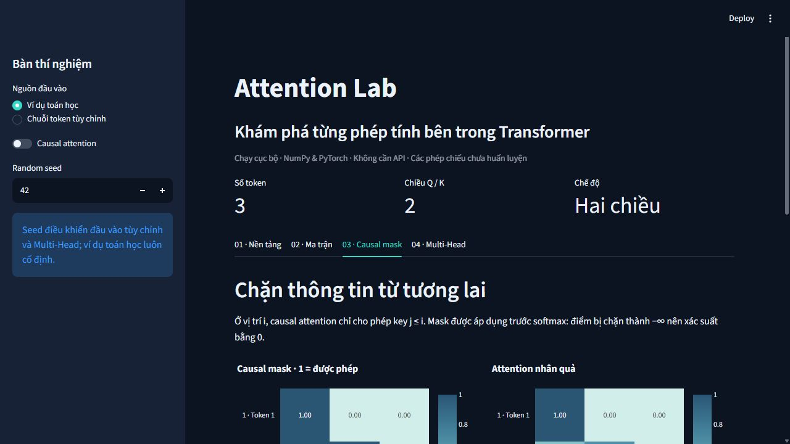
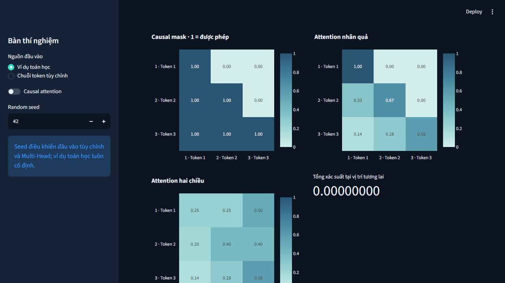

# Attention Lab 🔬

Phòng thí nghiệm tương tác giúp hiểu Transformer Attention qua **phép tính thật**,
triển khai từ đầu bằng NumPy và PyTorch. Giao diện Streamlit bằng tiếng Việt,
chạy cục bộ trên CPU, không cần API key, mô hình pretrained hoặc dịch vụ trả phí.

Mục tiêu: đi từ tích vô hướng đến attention nhiều head, kiểm tra kích thước tensor,
quan sát mask và hiểu cách tổng hợp thông tin. Các phép chiếu **chưa huấn luyện**.

## Mục tiêu học tập và tính năng

- Theo dõi Q, K, V → điểm thô → scaling → softmax → đầu ra.
- So sánh phân phối có/không scaling, chọn query và xem xác suất chính xác.
- Quan sát causal mask ngăn token truy cập vị trí tương lai.
- Tách head, ghép đầu ra và áp dụng phép chiếu cuối của Multi-Head Attention.
- Kiểm chứng NumPy/PyTorch, autograd và triển khai tham chiếu độc lập.

## Cài đặt và chạy

Yêu cầu Python 3.11 trở lên. Từ thư mục repository:

```bash
python -m venv .venv
```

Kích hoạt môi trường:

```powershell
# Windows PowerShell
.venv\Scripts\Activate.ps1
```

```bash
# macOS / Linux
source .venv/bin/activate
```

```bash
python -m pip install --upgrade pip
# Tùy chọn: bản CPU giúp tránh tải CUDA trên Linux.
python -m pip install torch --index-url https://download.pytorch.org/whl/cpu
python -m pip install -e ".[dev]"
python -m streamlit run app/main.py
```

Mở địa chỉ localhost được Streamlit in ra (mặc định cổng 8501).
Nếu `python` trỏ tới Windows Store alias, dùng `py -3.11` để tạo môi trường hoặc
chỉ rõ đường dẫn Python đã cài. Có thể gọi `.venv\Scripts\python.exe` trực tiếp.

## Toán học và kích thước

Với $X\in\mathbb{R}^{B\times T\times d_{model}}$:

$$Q=XW_Q,\quad K=XW_K,\quad V=XW_V$$

$$\operatorname{Attention}(Q,K,V)=\operatorname{softmax}\left(\frac{QK^T}{\sqrt{d_k}}+M\right)V$$

Softmax theo chiều **key**, trừ cực đại để ổn định số học:

$$\operatorname{softmax}(s)_j=\frac{e^{s_j-m}}{\sum_\ell e^{s_\ell-m}},\qquad m=\max_j s_j$$

Causal mask:

$$M_{ij}=\begin{cases}0&j\le i\\-\infty&j>i\end{cases}$$

$$head_i=\operatorname{Attention}(Q_i,K_i,V_i),\qquad
\operatorname{MHA}(X)=\operatorname{Concat}(head_1,\ldots,head_h)W_O$$

| Tensor | Functional / single-head | Multi-head |
|---|---|---|
| Q | `(..., Tq, dk)` | `(B, H, T, D/H)` |
| K | `(..., Tk, dk)` | `(B, H, T, D/H)` |
| V | `(..., Tk, dv)` | `(B, H, T, D/H)` |
| Điểm / trọng số | `(..., Tq, Tk)` | `(B, H, T, T)` |
| Đầu ra | `(..., Tq, dv)` | Sau ghép/chiếu: `(B, T, D)` |

Chiều batch phải khớp; mask boolean broadcast tới kích thước điểm số.
**True = được phép**, khác boolean mask của `torch.nn.MultiheadAttention`.
Padding mask cho MHA có dạng `(B, 1, 1, Tk)`. Hàng bị che hoàn toàn trả trọng số
và đầu ra bằng 0; chỉ hàng còn key hợp lệ mới có tổng xác suất 1.
Causal mask hình chữ nhật căn góc trên trái: key `j <= i`.

## Ví dụ kiểm chứng bằng tay

```python
import numpy as np
from attention_lab import mathematical_example, numpy_attention

q, k, v = mathematical_example()
# Q = [[1, 1], [0, 1], [1, 2]]
# K = V = [[1, 0], [0, 1], [1, 1]]
result = numpy_attention(q, k, v)
np.testing.assert_array_equal(result.raw_scores, [[1, 1, 2], [0, 1, 1], [1, 2, 3]])
np.testing.assert_allclose(result.weights.sum(-1), 1)
print(result.output)
```

Điểm đầu tiên: $[1,1]\cdot[1,0]=1$, sau scaling là $1/\sqrt{2}$.
Hàng trọng số đầu tiên là softmax của $[1,1,2]/\sqrt{2}$;
đầu ra hàng đó là tổng có trọng số của ba hàng V.

## Các khu vực tương tác

1. **Nền tảng:** công thức, bảng Q/K/V, phép tính cụ thể và các phép chiếu.
2. **Ma trận:** heatmap, chọn query, so sánh scaling và tổng từng hàng.
3. **Causal mask:** đối chiếu hai chiều/nhân quả, xác suất tương lai bằng 0.
4. **Multi-Head:** cấu hình token, D, H, seed; xem mọi head và đầu ra ghép/chiếu.

Đầu vào tùy chỉnh tách token theo khoảng trắng; SHA-256 tạo ánh xạ ổn định qua các
process. Token lặp có cùng embedding, chưa thêm positional encoding. Seed và
causal toggle dùng chung; Multi-Head có đầu vào ngẫu nhiên riêng. Ví dụ toán học
cố định không phụ thuộc seed. Tổ hợp D/H không hợp lệ được báo lỗi trên UI.

## Kiến trúc

```text
src/attention_lab/
  numpy_attention.py       # Kết quả trung gian cho trực quan hóa
  torch_attention.py       # Attention thủ công, mask và autograd
  attention.py             # Giao diện module single-head
  multi_head_attention.py  # Q/K/V, tách head, ghép và W_O
  multi_head.py            # Import tương thích cấu trúc ban đầu
  masking.py               # Causal mask và padding mask
  playground.py            # Embedding và phép chiếu tái lập
app/main.py                # Giao diện Streamlit tiếng Việt
tests/                     # Toán, tensor, gradient, reference và UI smoke tests
docs/                      # Giải thích toán học và thiết kế
.github/workflows/ci.yml   # Pytest, Ruff lint và format
```

Chi tiết: [Nền tảng toán học](docs/mathematical_foundations.md),
[Thiết kế và API](docs/architecture.md).

## Kiểm thử

```bash
python -m pytest tests/ -q
ruff check .
ruff format --check .
```

Suite đối chiếu với PyTorch SDPA và `nn.MultiheadAttention` chỉ trong test, kiểm tra
mask, hàng trống, float32/64, sai kích thước, gradient bằng finite differences,
seed và điều khiển Streamlit bằng AppTest. CUDA test tự bỏ qua nếu không có GPU.
Kết quả kiểm chứng thực tế được ghi trong `AI_TRACKER.md`.

## Ảnh giao diện

Ảnh chụp trực tiếp ứng dụng đang chạy trên localhost:





## Giới hạn và hướng mở rộng

- Đây không phải Transformer đầy đủ, GPT hay mô hình hiểu ngữ nghĩa.
- Không có huấn luyện, positional encoding, dropout, residual hoặc layer normalization.
- Tối đa 24 token tùy chỉnh và 16 token trong Multi-Head UI để dễ quan sát.
- Không hỗ trợ additive mask, KV cache hoặc batch broadcasting ngầm.
- Input phải hữu hạn; báo lỗi khi điểm số overflow. Float32/64 là dtype kiểm thử chính.
- `pyproject.toml` dùng khoảng phiên bản, không phải lockfile xuyên nền tảng.
  Seed tái lập trong cùng môi trường thư viện.
- Hướng mở rộng: positional encoding, bài tập notebook, cross-attention UI và toy training.

Giấy phép: xem [LICENSE](LICENSE).
